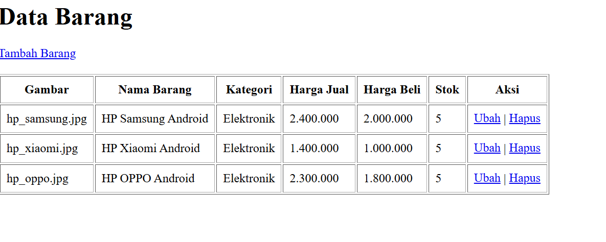
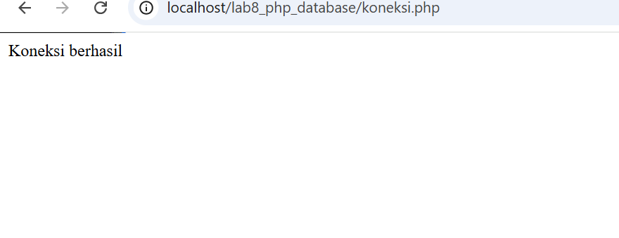
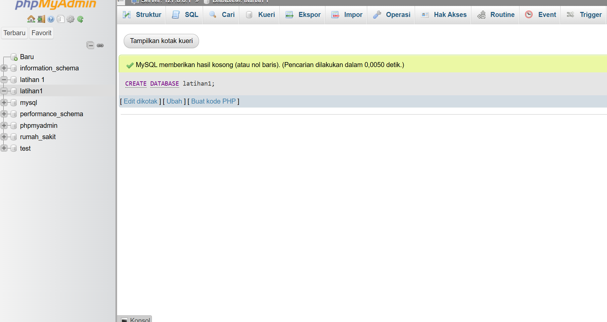
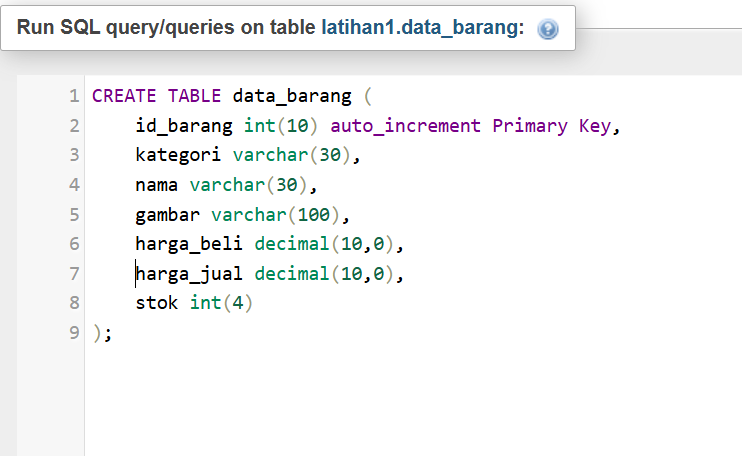
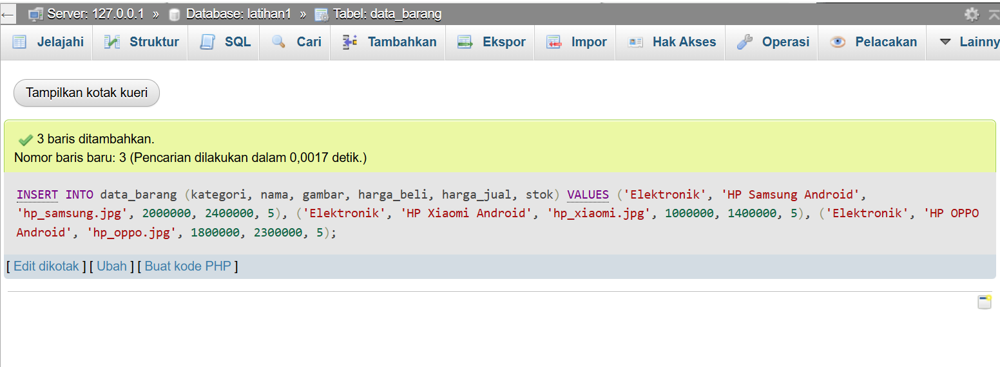
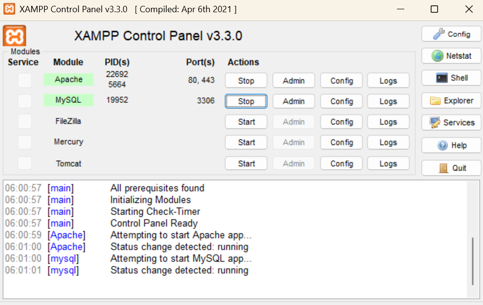
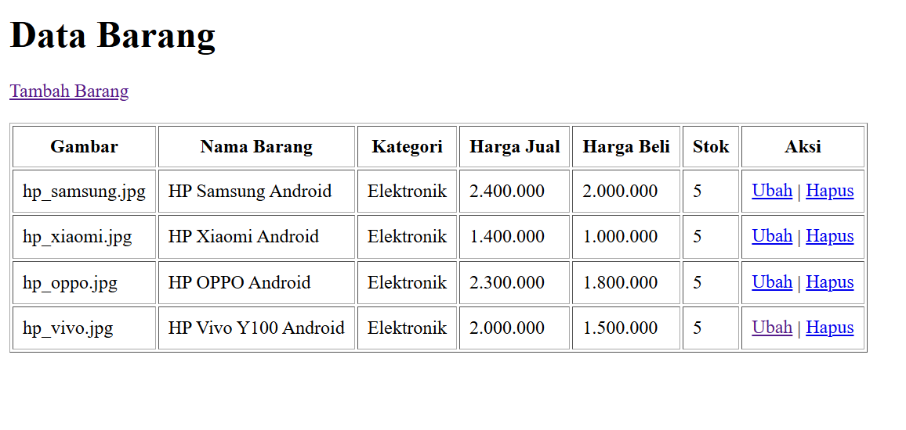
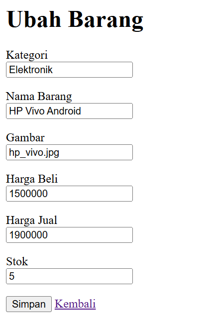
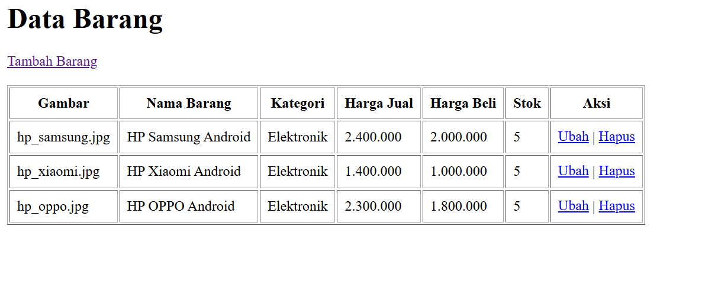

# LAB 8 - PHP DATABASE

## Praktikum PHP dan MySQL

Dokumentasi hasil praktikum membuat aplikasi CRUD menggunakan PHP dan MySQL.

### 1. Tampilan Data Barang

### 2. Koneksi PHP ke Database

### 3. Membuat Database

### 4. Membuat Tabel

### 5. Menambahkan Data

### 6. Menjalankan MySQL Server

### 7. Menambah Data PHP

### 8. Mengubah Data

### 9. Menghapus Data

